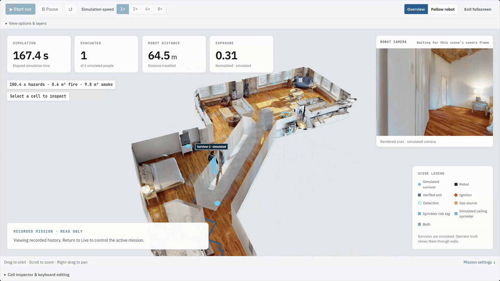
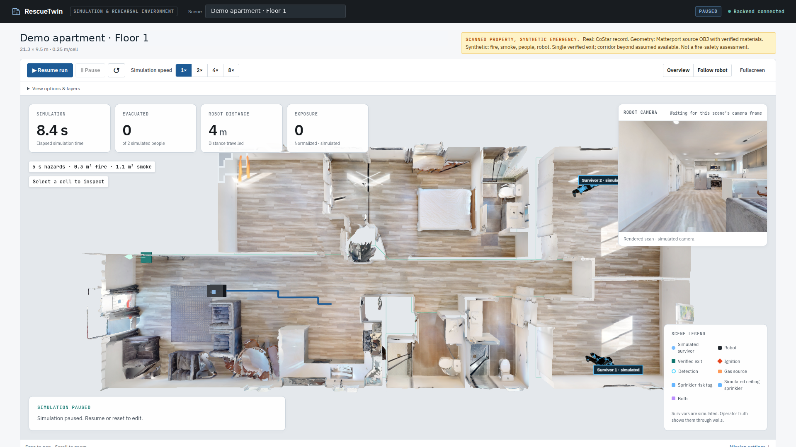
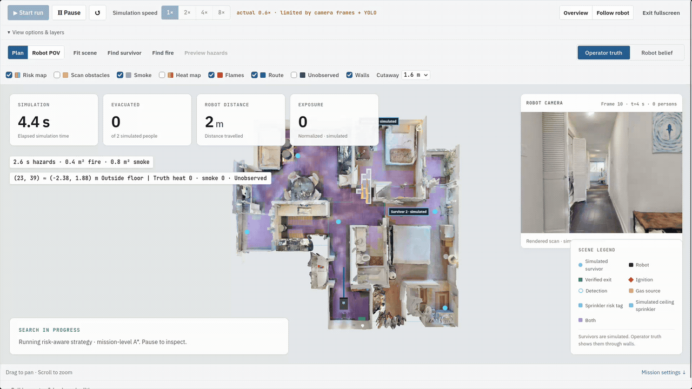
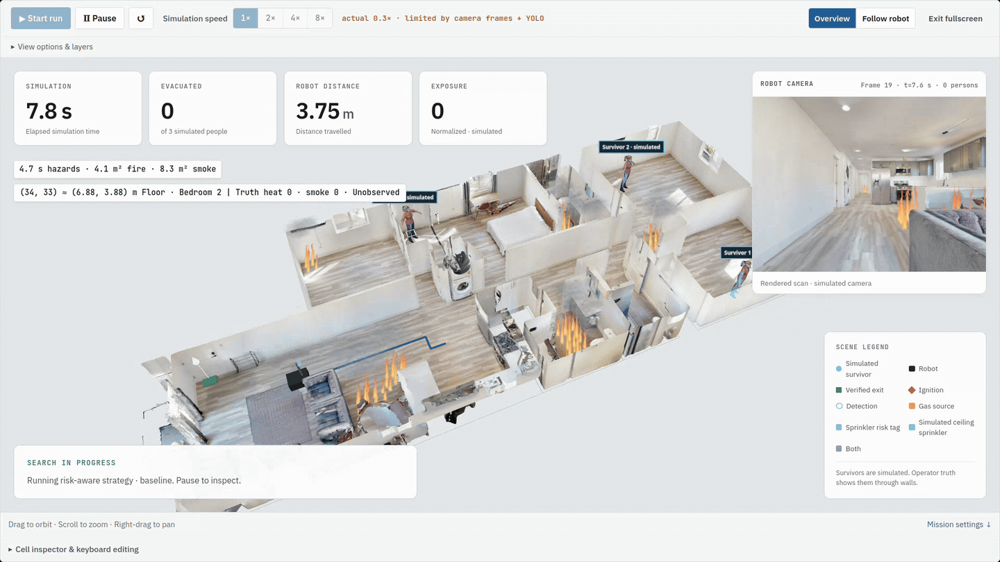
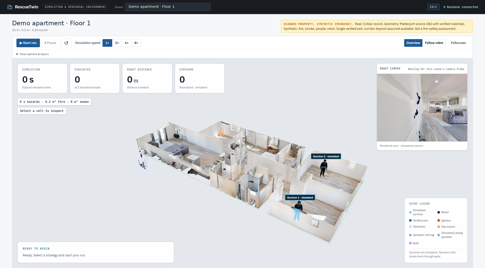
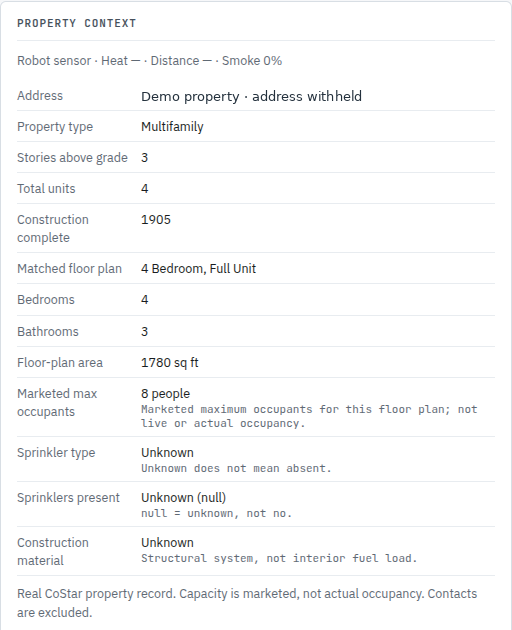
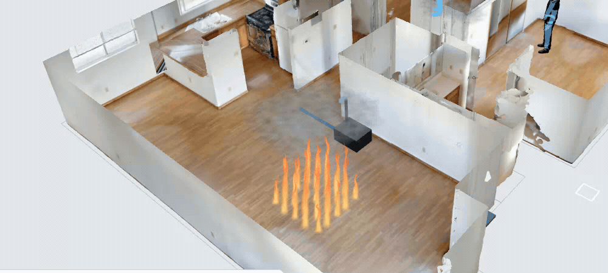
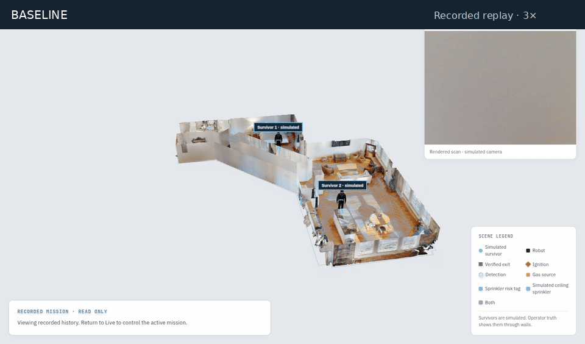
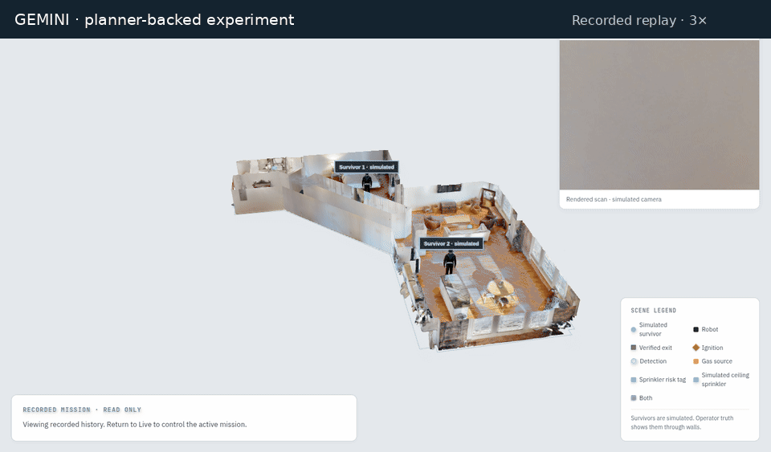

# RescueTwin

<table>
  <tr>
    <td width="25%"></td>
    <td width="25%"></td>
    <td width="25%"></td>
    <td width="25%"></td>
  </tr>
</table>

### Rehearse the rescue before the emergency.

RescueTwin turns building digital twins into interactive search-and-rescue rehearsals. Place simulated survivors and hazards inside a scan, then watch a robot search, adapt, and guide people toward verified exits.




## Who it serves

1. **First responders, fire departments, and real estate safety teams:** rehearse emergency scenarios in familiar buildings.
2. **Rescue robotics engineers:** test perception and planning in repeatable, scan-derived scenarios.

Our vision: make building digital twins useful for emergency preparedness and robotics development. The prototype covers one floor, one robot, and survivors who can follow.

## From property data to a rescue rehearsal

**Two integrated sponsor layers: CoStar building/property data and Matterport 3D digital twins.**

| Provided data or API | How RescueTwin uses it |
| --- | --- |
| CoStar **Commercial property** and **Apartment listing** datasets | Building use and property context; matched apartment floor-plan attributes and marketed maximum-occupant values for hypothetical workload presets. |
| CoStar **Residential listings** and **Residential listing features** datasets | Home characteristics and reported fixture attributes, including applicable gas and fire-sprinkler indicators. |
| Matterport **Model API**, floor/room spatial information, schematic floor plans, and **MatterPak bundles** | Textured interiors, scan-derived navigation geometry, reviewed exit annotations, and rendered robot-camera RGB-D. |

Marketed capacity is not live occupancy; unknown fields stay unknown. Vexcel is deferred.

| Property context | Simulated fire and smoke |
| --- | --- |
|  |  |

## Three ways to plan a mission

<table>
  <tr><th width="33%">Baseline</th><th width="33%">Mission A*</th><th width="33%">Gemini</th></tr>
  <tr>
    <td>Chooses the nearest unsearched room, confirms people, and escorts them to an exit.</td>
    <td>Plans the remaining mission using travel cost, survivor likelihood, and observed hazard urgency; replans as observations change.</td>
    <td>Uses robot observations to propose goals. The controller validates and executes them, with deterministic fallback on errors.</td>
  </tr>
  <tr>
    <td></td>
    <td></td>
    <td></td>
  </tr>
</table>

Edited replays share one frozen scenario; Gemini shows the planner-backed experiment. **Distance-only / risk-aware routing is a separate setting** from the mission algorithm.

## How it works

**Matterport geometry → Three.js RGB-D rendering → YOLO person detection → mission goals → A\* navigation and controller-checked escort.** Python/NumPy and FastAPI run the simulation; TypeScript/Three.js power the workbench. Gemini uses a server-side key. Runs record locally for read-only replay.

Building scans and property records are real; people, robot, fire, smoke, and camera imagery are simulated. Hazard sensing is simulated; operator truth is separate from robot belief. Gemini pauses time during inference by default. This prototype is not validated fire-safety guidance.

[User guide](docs/USER_GUIDE.md) · [Data and private setup](docs/DATA.md) · [Architecture](docs/ARCHITECTURE.md) · [Development](docs/DEVELOPMENT.md)

## Quickstart

**The demo data was provided by Matterport/CoStar and cannot be published with this repository.** Start with authorized sponsor access and a private reviewed scene manifest ([setup details](docs/DATA.md)).

Requires Python 3 with venv support, **Node 24** with npm, and `curl` on Linux/macOS or WSL.

```bash
nvm use
cp -n .env.example .env  # first setup; preserves an existing .env
# Edit .env with your private model selection and Matterport credentials.
# Put the authorized CoStar kit in data/costar-hackathon-kit/.
./setup.sh --import-scenes /absolute/path/to/private-scenes.json
```

Open **http://127.0.0.1:5173**. Apply a scenario, select a method, and start. Keep the browser open for RGB-D rendering. For later launches, set `RESCUETWIN_MODEL_ID` in `.env` to the imported model, then run `./setup.sh`. Ctrl+C stops both services.

Setup installs dependencies/assets. For Gemini, set `GEMINI_API_KEY` and optionally `GEMINI_MODEL` in `.env`, restart, then select **Gemini**. Baseline and Mission A* need no hosted model. Never commit credentials or private scene manifests.
