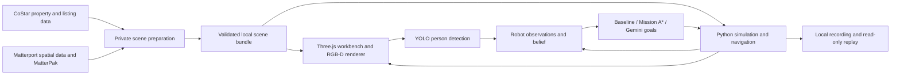

# Architecture

RescueTwin combines static building scans with a local emergency simulation and a browser-rendered robot camera. The operator can inspect simulator truth; mission decisions use observations and belief.

## Scene preparation

Private annotations define floor scope, registration, robot start, and manually reviewed exits. Preparation combines Matterport spatial information and schematic floor plans with CoStar record joins. Textured MatterPak OBJ/MTL assets supply the rendered scan and geometry reconciliation. Validation checks asset integrity and navigability before publication; failed rebuilds retain the previous bundle.

Prepared bundles live in ignored `data/prepared/`. Each contains scene geometry, assets, navigation cells, assumptions, source provenance, and checks. Model IDs and source records remain local. The scene registry loads valid bundles alongside a labeled synthetic development fixture.

## Runtime loop

FastAPI owns scenario state and the simulation clock. NumPy arrays represent heat, smoke, and local belief. The controller executes grid A* navigation and simulated escort. Baseline chooses nearby search goals; Mission A* plans remaining mission goals; optional Gemini proposes goals from observations. All retain controller validation and human escort constraints.

The TypeScript/Three.js frontend renders the textured scan, synthetic people, and hazards. In image mode it renders synchronized RGB and depth from the requested robot pose. The backend detects people using YOLO, projects detections into the static map with depth, and maintains perception-assigned tracks. The browser must remain available to supply frames. Camera imagery comes from the scan renderer, not a live feed.

Fire, smoke, gas incidents, and sprinkler behavior are illustrative simulation mechanisms. Hazard measurements are analytic simulated sensors; YOLO is person detection only. CoStar building-use context can inform room-search priors, while marketed capacity only configures hypothetical workloads.

## Knowledge and safety boundaries

- **Operator/evaluation truth:** full hazard fields, scenario placements, and simulated survivor entities.
- **Robot belief:** static scanned map and known localization, local observations, perception tracks, coverage, and observed hazards. Hidden survivor placements are excluded.
- **Execution:** goal proposals cannot bypass controller checks. Human escort limits remain in force even where the simulated robot can travel alone.
- **Development fixtures:** analytic perception uses simulator truth and is explicitly labeled; it does not establish image-based performance.

The [robot constitution](ROBOT_CONSTITUTION.md) defines mission intent and is loaded by the interactive supervisor. Its aspirational reporting requirements are distinguished from implemented controller behavior in its runtime-status section.

## Recording and comparisons

Recordings preserve scene assets, frozen scenario inputs, state history, submitted camera evidence, and decisions locally. Replay reads historical artifacts without executing inference or changing the live mission.

Paired distance-only/risk-aware comparisons freeze the scenario, sensors, hazards, and immediate safety rules. They exclude hosted reasoning. Tool-backed Gemini experiments use separate bounded tools and explicit campaign approval. Interactive Gemini normally pauses the mission clock during inference, so mission time is not a real-time latency measurement.

The prototype assumes one floor, one kinematic robot, static geometry, known localization, and survivors who can follow. It does not implement SLAM, physical manipulation, carrying, or structural collapse. See [Development](DEVELOPMENT.md) for interfaces and checks.
